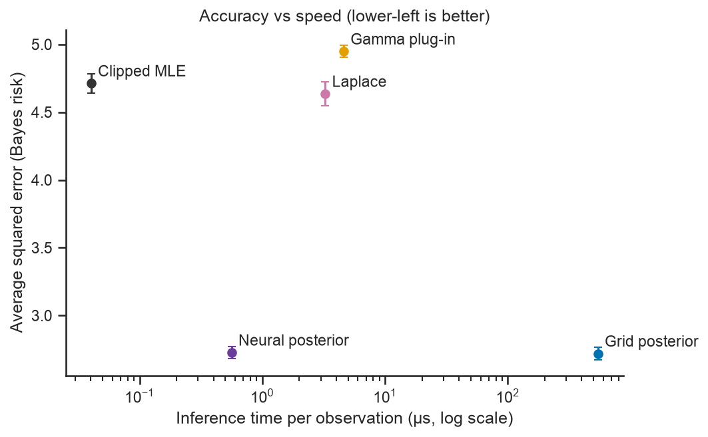
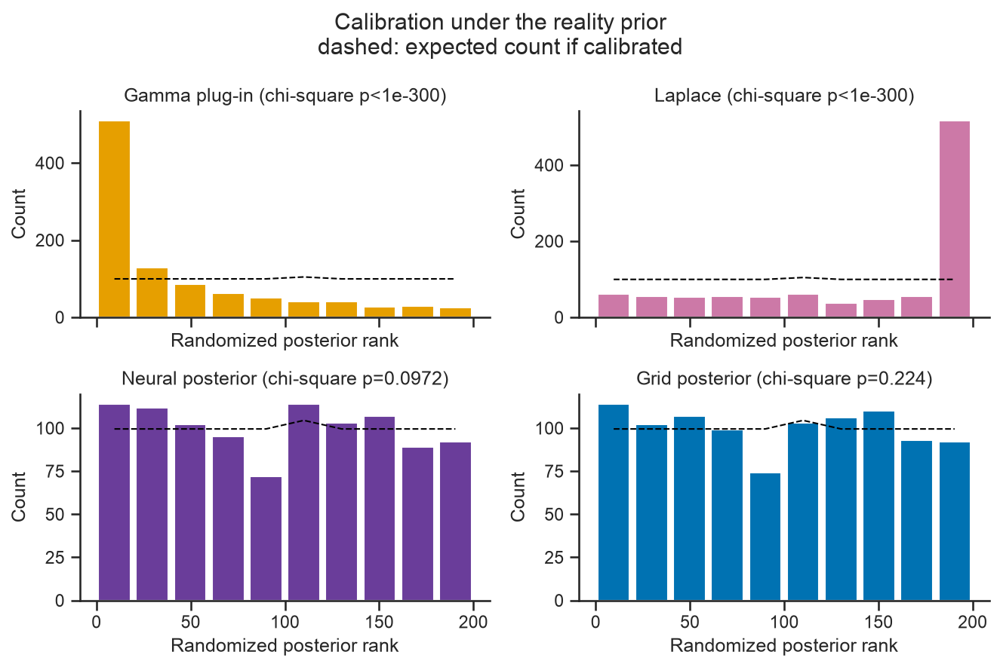
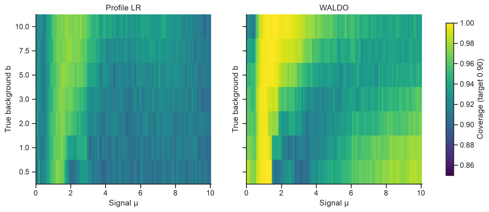
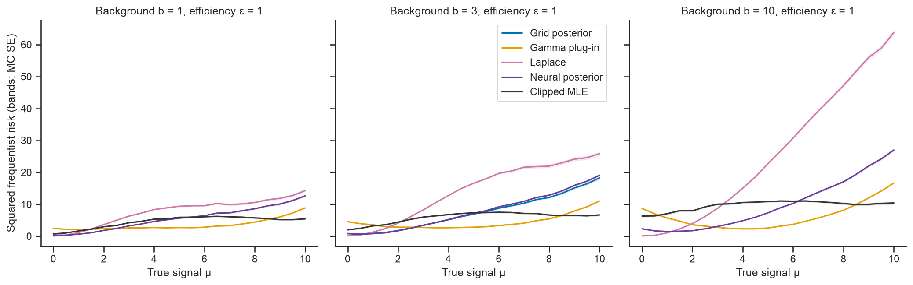
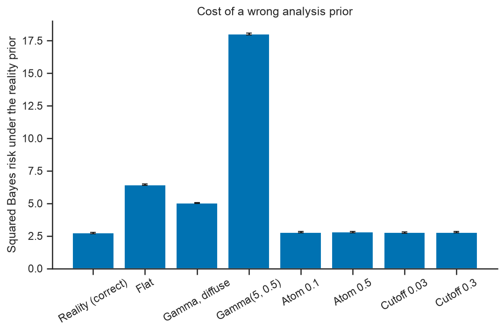

# Pragmatic Bayes and Bounded Frequentism

**When data are scarce and the answer cannot be negative, which do you trust: a Bayesian answer that is best on average, or a frequentist answer that is built to hold for every possible truth? This project measures both on one simulator and shows where each one wins and where each one fails.**

[](https://github.com/luisgius/bayes-frequentist/actions/workflows/ci.yml)
[](LICENSE)
[](pyproject.toml)
[](https://github.com/astral-sh/ruff)

**[View the notebook](https://nbviewer.org/github/luisgius/bayes-frequentist/blob/main/notebooks/01_holy_war_reconciliation.ipynb)** · [Full results tables](#7-full-results-tables) · [Literature review](docs/literature_review.md)


*Left: average squared error (Bayes risk) against inference time for five estimators; lower-left is better. The neural posterior's Bayes risk is close to the exact grid calculation's (2.727 ± 0.046 vs 2.719 ± 0.046; paired difference on the same data +0.008 ± 0.004), and it is about 960 times faster. Right: how often each interval contains the true signal when the truth is held fixed (coverage), at background b = 3 and efficiency ε = 1. The Bayesian credible intervals contain it only about 80% of the time for signals from 3 to 8.5 and never at the upper edge μ = 10. The two calibrated confidence methods stay near the dashed 90% target: their lowest values on this slice, each the lowest of 104 noisy estimates, are 0.898 ± 0.005 and 0.9125 ± 0.0045. "±" is one Monte Carlo standard error.*

## TL;DR

- **The problem.** Estimate a weak signal rate μ from a few counts. μ cannot be negative or larger than 10, and the background and the detector efficiency are only partly known.
- **Fast Bayes works on average.** A neural posterior (a small network trained once on simulations, in about 5 s on a laptop CPU) has almost the same average squared error as an exact grid calculation (2.727 ± 0.046 vs 2.719 ± 0.046; paired difference on the same data +0.008 ± 0.004). It runs about 960 times faster (0.56 µs vs 541 µs per observation).
- **"Good on average" is not "good everywhere".** On average over the prior (the distribution of plausible true values), the Bayesian credible interval contains the truth 94.6% of the time. That is as often as it promises: most intervals start at μ = 0, where the prior has a point mass, and then hold at least 95% of the posterior, so on average they hold 94.7%. At fixed signals between 3 and 8.5, though, it contains the truth only 79–82% of the time, and at μ = 10 never (b = 3, ε = 1). The prior expects weak signals, so it pulls strong ones low.
- **Calibrated confidence sets pass the coverage check, if you calibrate for every unknown.** Profile likelihood (which re-fits the unknown background and efficiency for each candidate signal) and WALDO (which builds confidence sets from the neural posterior) are calibrated by simulation for 90% coverage. At 300 random points that the calibration never used, both pass the 0.885 check (lowest 0.897 ± 0.005 and 0.895 ± 0.005). Calibrated at efficiency ε = 1 only, both fail there (lowest 0.855 ± 0.002 and 0.870 ± 0.002).
- **Checked against the literature.** With the authors' own correction, all 420 entries of the published Feldman–Cousins 90% tables (the standard physics method for intervals near a boundary) match within 0.01.
- **Bottom line.** Each approach wins on its own criterion, as theory says it must when the prior is right. Only the frequentist guarantee needs no prior: with a flat prior, the posterior mean does worse than the simple clipped maximum-likelihood estimate (+1.72 ± 0.05 in squared error, same data). This is a careful comparison on one simulator, not a resolution of the Bayesian–frequentist debate.

Terms such as *Bayes risk*, *coverage* and *WALDO* are explained in plain words in [Key terms](#2-key-terms-in-plain-words).

## Why this matters beyond physics

The same structure, a nonnegative excess rate over a background that must also be estimated, from few events, appears in other fields. For example:

- **Drug safety:** the extra rate of an adverse event above its usual background rate, from a handful of reports.
- **Reliability:** a rare failure rate when the test also misses some failures (an efficiency below 1).
- **Environmental monitoring:** contamination above a natural background level that is measured at a control site (like the "off" measurement here, which has 5 times the exposure).

In each case, an estimate that is most accurate on average and an interval that keeps its promise for every true value can disagree, and it pays to check both. This project shows how to measure both and how to report the trade-off honestly. The evidence comes from one simulator. Whether the conclusions carry over depends on the constraint being real (an A/B-test lift, for example, can be negative) and on how well the prior is known.

## What this project demonstrates

- **Simulation study design:** one shared simulator for every method; every simulated number comes with its Monte Carlo standard error; methods scored on the same draws are compared with paired standard errors; seeds, runtimes and package versions are recorded.
- **Machine learning for inference:** an amortized neural posterior in PyTorch (train once, then answer any new data set in microseconds), checked with simulation-based calibration (a standard test of whether a posterior is computed correctly) and directly against the exact posterior. The direct check finds a small fixed-signal coverage deficit that the standard test misses.
- **Statistical judgement:** choosing the success criterion (average error or coverage at every true value), testing every method under both, separating checks that hold by construction from real tests, and reporting the failures (a Laplace approximation caught at the prior's lower cutoff, naive Wald intervals near zero, a wrong prior).
- **Reproducing published work:** all 420 entries of the Feldman–Cousins 90% tables, with the authors' own correction.
- **Software engineering:** an installable Python package with type hints, unit and reference-value tests, ruff, GitHub Actions CI that runs the tests and the notebook, and a notebook that walks through the saved results.

## Contents

1. [The question](#1-the-question)
2. [Key terms in plain words](#2-key-terms-in-plain-words)
3. [Setup and success criteria](#3-setup-and-success-criteria)
4. [Path A: pragmatic computational Bayes](#4-path-a-pragmatic-computational-bayes)
5. [Path B: domain-restricted frequentism](#5-path-b-domain-restricted-frequentism)
6. [The reconciliation: each method under the other's criterion](#6-the-reconciliation-each-method-under-the-others-criterion)
7. [Full results tables](#7-full-results-tables)
8. [Limitations and next steps](#8-limitations-and-next-steps)
9. [Installation and quickstart](#9-installation-and-quickstart)
10. [Reproducibility](#10-reproducibility)
11. [Repository structure](#11-repository-structure)
12. [References](#12-references)
13. [License](#13-license)

## 1. The question

Bayesian and frequentist statistics are often presented as rival camps. A more useful view is that they answer different questions and give different **guarantees**:

- A **Bayesian** procedure is optimal *on average* over a prior distribution of parameter values.
- A **frequentist** procedure aims at a guarantee *for every* parameter value, for example "this interval contains the true value in at least 90% of repeated experiments".

Many statisticians now combine the two. Rubin (1984) and Little (2006) call this *calibrated Bayes*: use Bayesian inference within a model, and use frequentist calculations to check it. Kass (2011) calls a similar position *statistical pragmatism*.

**The test case.** We use an **on/off counting experiment**, as in gamma-ray astronomy or radiation detection.

- The *on* region contains the source. We observe $n_{\text{on}}$ counts from signal plus background.
- The *off* region contains no source. We observe $n_{\text{off}}$ background-only counts. Its exposure is $\tau = 5$ times larger than the on region.
- A separate calibration gives a noisy measurement $\hat\varepsilon$ of the detector efficiency $\varepsilon$.

The unknowns are the **signal** $\mu \in [0, 10]$ (the quantity we want), the **background** $b$ and the **relative efficiency** $\varepsilon$ (two *nuisance parameters*: unknowns that we must account for but do not care about). The upper bound $\mu_{\max} = 10$ stands for a known maximum source activity or detector saturation.

**Why the boundary matters.** A source cannot emit a negative number of photons, so $\mu \ge 0$. Near $\mu = 0$, textbook frequentist intervals can be empty or negative. Choosing between an upper limit and a two-sided interval after seeing the data ("flip-flopping") breaks the coverage guarantee (Feldman & Cousins 1998). The prior also matters most near the boundary, because the data say little there. Note that a constraint does not *force* a Bayesian analysis: frequentist methods can use constraints too, and a prior adds information beyond the constraint (Stark 2015). This repository shows, with numbers and Monte Carlo errors, where the two views agree and where they differ.

We study two cases:

| Case | Background $b$ | Efficiency $\varepsilon$ | Purpose |
|---|---|---|---|
| **Core** | known, $b = 3$ | fixed, $\varepsilon = 1$, no calibration noise | Exact checks against the published Feldman–Cousins tables |
| **Full** | unknown, $b \in [0.5, 10]$ | uncertain, log-normal with log-scale SD 0.1 | Realistic analysis with nuisance parameters |

This problem is a standard test bed in physics intervals (Feldman & Cousins 1998; Rolke et al. 2005) and in machine-learning-based frequentist inference (Dalmasso et al. 2024; Al Kadhim et al. 2023). It is cheap to simulate, so Monte Carlo errors stay small. See [`docs/literature_review.md`](docs/literature_review.md) for the full background.

## 2. Key terms in plain words

- **Prior and posterior:** the prior describes what we believe about the unknowns before seeing the data; the posterior is the updated belief after seeing them.
- **Bayes risk:** the average error of an estimate, averaged over many plausible true values drawn from a prior. Here the error is squared error. Lower is better.
- **Coverage:** how often an interval contains the true value if the experiment is repeated with the truth held fixed. A 90% confidence procedure aims for at least 90% coverage at *every* true value; here we check this on finite sets of true values.
- **Worst-case coverage:** the lowest coverage over all checked true values. The frequentist validity criterion is that coverage reaches the target at every true value (here: that the procedure passes the check in Section 3); among procedures that pass, smaller sets are better.
- **Credible interval:** a Bayesian interval built from the posterior. We use the *equal-tailed* rule with α = 0.1: the interval runs from the 5% to the 95% posterior quantile. The posterior has a point mass at μ = 0, so the 5% quantile is often 0. The interval then starts at 0 and holds at least 95% of the posterior, not 90%. In this study 92.7% of the intervals start at 0, and the intervals hold 94.7% of the posterior on average.
- **Confidence set:** a frequentist set of signal values, built so that it targets 90% coverage at every true value.
- **Nuisance parameter:** an unknown that we do not care about but must account for (here the background $b$ and the detector efficiency $\varepsilon$).
- **Reality prior:** the distribution the simulator uses to draw "true worlds" (30% no source, 70% a source of varying strength).
- **Feldman–Cousins (FC):** a standard 1998 physics recipe for 90% intervals that respect the boundary $\mu \ge 0$ and are never empty.
- **Profile likelihood ratio:** a test that handles nuisance parameters by re-fitting them for each candidate signal value.
- **WALDO:** a 2023 method that turns a posterior (here the neural one) into a confidence set, by calibrating its test statistic with simulations so that it targets frequentist coverage.
- **Amortized neural posterior:** a network trained once on simulated data. It then returns a posterior for any new data set in microseconds.
- **SBC (simulation-based calibration):** if a posterior is computed correctly for the prior that generated the data, the true value looks like a random draw from it. SBC checks this over many simulated data sets.
- **Toys:** simulated repeat experiments, used to estimate coverage.
- **Calibration node:** a point $(\mu, b, \varepsilon)$ at which the frequentist cutoffs were computed by simulation. Coverage of about 90% at a node holds by construction, so the real test is at points off the nodes.
- **Paired difference:** when two methods are scored on the same simulated draws, we compute their difference draw by draw. Its standard error is often much smaller than either method's own.
- **Hull:** the shortest single interval that contains a confidence set (some sets have small gaps). Exact belts round its ends outward to the next grid node (Section 3).
- **MC SE:** Monte Carlo standard error, the uncertainty that comes from using a finite number of simulations. Every "±" in this README is one MC SE.

## 3. Setup and success criteria

**Model.** In the full case, given the parameters $\theta = (\mu, b, \varepsilon)$, the three observations $x = (n_{\text{on}}, n_{\text{off}}, \hat\varepsilon)$ are independent:

$$
n_{\text{on}} \sim \mathrm{Poisson}(\varepsilon\mu + b), \qquad
n_{\text{off}} \sim \mathrm{Poisson}(\tau b), \qquad
\log\hat\varepsilon \sim \mathcal N(\log\varepsilon,\ \sigma_\varepsilon^2),
$$

with $\tau = 5$ and $\sigma_\varepsilon = 0.1$. In the core case, $b = 3$ is known, $\varepsilon = 1$ and $\sigma_\varepsilon = 0$, so $\hat\varepsilon = 1$ and only $n_{\text{on}} \sim \mathrm{Poisson}(\mu + 3)$ carries information. The physical signal space is $\Theta = [0, \mu_{\max}]$ with $\mu_{\max} = 10$.

**Nuisance box.** The frequentist coverage checks use only points inside the box $\mathcal B = [0.5, 10] \times [e^{-0.2}, e^{0.2}]$ for $(b, \varepsilon)$, that is $\varepsilon \in [0.819, 1.221]$. We make no coverage claim outside this box.

**Reality prior.** The simulator draws the three parameters independently, from a prior $\pi$ that encodes "no source or a weak source is common":

$$
\mu \sim 0.3\,\delta_0 + 0.7\,\mathrm{LogUniform}[0.1, 10], \qquad
b \sim \mathrm{Uniform}[0.5, 10], \qquad
\log\varepsilon \sim \mathcal N(0, 0.1^2),
$$

where $\delta_0$ is a point mass at $\mu = 0$. The efficiency prior has no upper bound; the nuisance box limits only the coverage checks, not the simulator.

**Loss and risk.** An estimator $\delta$ maps data $x$ to an estimate $\delta(x)$ of $\mu$. The primary loss is squared error, $L(\mu, a) = (a - \mu)^2$; we also report absolute error $\lvert a - \mu \rvert$.

- The **frequentist risk** is the expected loss at one fixed parameter value:
  $R(\theta, \delta) = \mathbb E_{X \mid \theta}\, L\big(\mu, \delta(X)\big)$.
- The **Bayes risk** averages the risk over the prior:
  $r(\pi, \delta) = \mathbb E_{\theta \sim \pi}\, R(\theta, \delta)$.
  Under squared loss, the posterior mean $\mathbb E[\mu \mid x]$ minimizes it.

We estimate $r$ by Monte Carlo with $M = 20{,}000$ draws $(\theta_i, x_i)$:

$$
\hat r = \frac{1}{M}\sum_{i=1}^{M} L\big(\mu_i, \delta(x_i)\big), \qquad
\mathrm{SE}(\hat r) = \frac{s_L}{\sqrt M},
$$

where $s_L$ is the sample standard deviation of the losses. All Path A estimators are scored on the same draws, so a difference between two of them gets a **paired** SE: the same formula applied to the per-draw differences of their losses.

**Coverage and the pass rule.** An interval procedure maps $x$ to a set $\mathrm{CI}(x) \subseteq \Theta$. Its coverage function is

$$
C(\theta) = P_\theta\big(\mu \in \mathrm{CI}(X)\big).
$$

We target $1 - \alpha = 0.90$ and evaluate coverage at finitely many points. A procedure passes our empirical check when its estimated coverage is at least $1 - \alpha - \text{tol}$ at every checked point.

- **Core case.** We compute $C$ exactly by summing over counts, with $\text{tol} = 0.005$. The exact FC and WALDO belts are built on a signal grid with step 0.01, and at those grid nodes coverage holds by construction. So we evaluate them on a scan with step 0.001 (10,001 points, on and between the nodes).
- **Full case.** We use $N = 4{,}000$ simulated experiments ("toys") per point, with binomial standard error $\sqrt{\hat C (1 - \hat C)/N} \approx 0.0047$ and $\text{tol} = 0.015$ (about 3 standard errors), so the pass threshold is 0.885. Points below the threshold are rerun with 40,000 toys before they count as failures.

**What a pass means.** The rule is built to avoid false failures, not to detect small shortfalls. Exact binomial sums give its operating characteristic: a point whose true coverage is 0.89 passes with probability 0.9999, a point at 0.885 with probability 0.758, and a point at 0.88 with probability 0.172. So a pass means that no checked point is clearly below about 0.885; it does not prove 0.90. In the other direction, even if all 728 points of a grid had true coverage exactly 0.90, at least one would be flagged at the first stage with probability 0.473, which is why flagged points are rerun. A pass is empirical evidence at finitely many points, not a proof of 90% coverage everywhere in the continuous parameter space. For a Bayesian credible interval, $C(\theta)$ is a measured property, not a design target.

<details>
<summary><b>Method details: formulas for Feldman–Cousins, profile likelihood, WALDO and calibration</b></summary>

**Feldman–Cousins (FC) ordering.** For known $b$, the FC method (Feldman & Cousins 1998) builds an acceptance set $A(\mu)$ of counts for each $\mu$. Counts $n$ enter in decreasing order of the likelihood ratio

$$
R_{\text{FC}}(n; \mu) = \frac{P(n \mid \mu)}{P(n \mid \mu_{\text{best}})}, \qquad
\mu_{\text{best}} = \min\big(\max(0,\ n - b),\ \mu_{\max}\big),
$$

until $\sum_{n \in A(\mu)} P(n \mid \mu) \ge 1 - \alpha$. Here $\mu_{\text{best}}$ is the best *physically allowed* fit. The interval for an observed count $n_0$ is the set of $\mu$ with $n_0 \in A(\mu)$.

**FC's correction in $b$.** For a fixed count, the upper end of this interval does not always fall as $b$ grows. FC (1998, Sec. IV A) force it to be non-increasing by lengthening intervals where needed. We do the same for every count: the corrected upper end at $b$ is the largest plain upper end over an auxiliary grid of backgrounds $b' \ge b$ (0 to 25 in steps of 0.01).

**Reported endpoints.** Exact belts (FC, and WALDO in the core case) report outward-rounded endpoints, as FC do: the lower end is the grid node just below the lowest accepted node, and the upper end is the node just above the highest one, within $\Theta$. The calibrated full-case sets report the inclusive hull described below.

**Profile likelihood ratio.** With unknown nuisances we use

$$
t_\mu(x) = -2 \log \frac{L\big(\mu, \hat{\hat b}(\mu), \hat{\hat\varepsilon}(\mu)\big)}{L\big(\hat\mu, \hat b, \hat\varepsilon\big)},
$$

where the hatted values maximize the likelihood $L$ with $\hat\mu \in \Theta$, and the double-hatted values maximize it at fixed $\mu$.

**WALDO statistic.** WALDO (Masserano et al. 2023) builds a test statistic from any posterior estimator:

$$
T_{\text{W}}(x; \mu_0) = \frac{\big(\mathbb E[\mu \mid x] - \mu_0\big)^2}{\mathbb V[\mu \mid x]},
$$

where $\mathbb E[\mu \mid x]$ and $\mathbb V[\mu \mid x]$ are the posterior mean and variance. In the full case they come from the Path A neural network; in the core case, from an exact flat-prior posterior. A small floor ($10^{-8}$) keeps the variance positive.

**Calibration.** For a statistic $T$ (profile LR or WALDO) in the full case, the *coarse cutoff* at each node $\mu_j$ of a 101-point signal grid (step 0.1 on $[0, 10]$) is the worst case over the nuisance grid:

$$
c_j = \max_{(b, \varepsilon) \in \mathcal B_{\text{grid}}} q_{1-\alpha}\big(T(X; \mu_j) \mid \mu_j, b, \varepsilon\big).
$$

Here $q_{1-\alpha}$ is a conservative empirical 90% quantile from 5,000 toys (order statistic 4,501), and $\mathcal B_{\text{grid}}$ has 7 background × 5 efficiency values. In the core case, WALDO cutoffs come from exact Poisson sums instead of toys.

**Envelope and inversion.** Before inversion, each coarse cutoff is raised to the maximum of itself and its two neighbours (the end values are repeated), and this envelope is interpolated linearly onto a finer signal grid with step 0.01:

$$
e_j = \max\big(c_{j-1},\ c_j,\ c_{j+1}\big), \qquad
\tilde c(\mu_0) = \text{linear interpolation of } (\mu_j, e_j) \text{ at } \mu_0,
\qquad
\mathrm{CI}(x) = \lbrace \mu_0 \in \Theta_{0.01} : T(x; \mu_0) \le \tilde c(\mu_0) \rbrace ,
$$

where $\Theta_{0.01}$ is the signal grid with step 0.01. Between two nodes, $\tilde c$ is at least the larger of the two original cutoffs. The reported interval is the inclusive **hull** of $\mathrm{CI}(x)$: from its smallest to its largest accepted grid value, or empty if no value is accepted. The envelope is a numerical convention that removes isolated low cutoffs at the nodes; it does not prove coverage between nodes.

</details>

## 4. Path A: pragmatic computational Bayes

We compare five estimators of $\mu$, all evaluated on the **same** 20,000 draws from the reality prior:

1. **Grid posterior** (gold standard): exact posterior under the reality prior, by numerical quadrature over $\mu$, $b$ and $\varepsilon$. Accurate but slow.
2. **Gamma plug-in**: a truncated Gamma-mixture posterior under a different, diffuse analysis prior (Gamma with shape 1 and rate 0.1, no point mass at zero), with the background fixed at $\hat b = n_{\text{off}}/\tau$ and the efficiency at $\hat\varepsilon$.
3. **Laplace**: a local quadratic approximation, in $\mu$, of the reality-prior log posterior around its mode, with plug-in values for $b$ and $\varepsilon$.
4. **Neural posterior** (amortized simulation-based inference): a small PyTorch network trained on 50,000 simulated pairs $(\theta, x)$. It outputs a probability for $\mu = 0$ plus 100 bins on $(0, 10]$. Training took 4.97 s on a laptop CPU.
5. **Clipped MLE**: the maximum-likelihood estimate restricted to $\Theta$ (frequentist baseline).



*Squared Bayes risk (error bars: one MC SE) against median batched inference time per observation (log scale). Lower-left is better.*

**Findings.**

- **The neural posterior is almost as accurate as the grid posterior.** On the same 20,000 draws, its Bayes risk exceeds the grid posterior's by 0.0078 ± 0.0044 (paired SE; each risk on its own has an SE of 0.046). The grid posterior mean is the Bayes rule here, so the neural posterior's excess risk can also be measured directly, as the mean of $(\delta_{\text{NN}} - \delta_{\text{grid}})^2$: 0.0144 ± 0.0006, about half a percent of the risk. The neural posterior costs 0.561 µs per observation, against 540.95 µs for the grid posterior.
- Gamma plug-in, Laplace and the clipped MLE are all clearly worse on average (Bayes risk from 4.635 ± 0.089 to 4.948 ± 0.043). On the same draws they exceed the grid posterior by 1.916 ± 0.058 (Laplace), 1.994 ± 0.058 (clipped MLE) and 2.229 ± 0.041 (Gamma plug-in); see the [tables](#7-full-results-tables).
- Speed is not correctness. **Simulation-based calibration** (SBC; Talts et al. 2018) checks a posterior against the prior that generated the data: if the posterior is right, the rank of the true $\mu$ among posterior draws is uniform. All four posteriors are checked against the same reference, the reality prior, on the same 1,000 simulated data sets with 200 draws each (so the four p-values are not independent tests). The grid and neural posteriors show no rejection at the 5% level (χ² p = 0.224 and 0.097). Gamma plug-in and Laplace show strong departures (p below 1e-300): 50.9% ± 1.6% and 51.6% ± 1.6% of their ranks fall in one extreme bin, against 10% for a uniform rank. The causes differ. Gamma's rejection comes mainly from its prior: it has no point mass at 0, so it ranks every truth with $\mu = 0$ (30% of the reality prior) at 0. Laplace's rejection comes from the spurious mode described below.



*SBC rank histograms under the reality prior. The dashed line is the expected count for a calibrated posterior.*

- **SBC is a weak test, and the exact posterior allows a stronger one.** On the Bayes-risk draws, the mean KL divergence from the exact to the neural posterior (after binning the exact posterior into the network's 101 classes) is 0.0186 ± 0.0003 nats (95th percentile 0.062), and the two posterior variances correlate at 0.994. At fixed signals, however, a paired comparison on shared toys shows that the neural intervals cover less often than the exact posterior's at every μ from 3 to 9.5 (b = 3, ε = 1), by up to 0.0245 ± 0.0029 at μ = 9.5. SBC did not detect this small approximation error.
- **Laplace finds a spurious mode at the prior's lower cutoff.** The approximation is a quadratic expansion in $\mu$. In $\mu$, the log-uniform part of the prior adds a $-\log\mu$ term to the log posterior, and this term can make the lower cutoff $\mu = 0.1$ the highest point. The approximation then piles its mass near 0.1 and misses the bulk of the posterior. This inflates the risk for most signals above about 2, at every background. At b = 3 its risk is more than twice the grid posterior's for every μ from 1.5 to 7 (for example 8.26 ± 0.03 vs 3.46 ± 0.05 at μ = 3). At $(\mu, b, \varepsilon) = (10, 10, 1)$ it is 63.76 ± 0.69, against 26.98 ± 0.33 for the neural posterior. In $\log\mu$ the prior is flat, so expanding in $\log\mu$ is the natural fix; we keep the failure in the results on purpose.

## 5. Path B: domain-restricted frequentism

We target 90% coverage at every $\mu$ in $\Theta$ and check it at finitely many points, with the pass rule of [Section 3](#3-setup-and-success-criteria). We compare:

- **Feldman–Cousins** (core case, exact).
- **Profile likelihood ratio** and **WALDO** (full case), calibrated over the nuisance box as in Section 3.
- **Baselines:** the naive Wald interval $\hat\mu \pm 1.645\,\widehat{\mathrm{sd}}(\hat\mu)$, built from the unclipped estimate $\hat\mu$ (for example $n_{\text{on}} - b$ in the core case) and then intersected with $\Theta$; central Neyman intervals and upper limits (valid only if the choice is made before seeing data); and the equal-tailed 90% Bayesian credible interval under a flat prior on $\Theta$.

**Findings.**

- **FC is reproduced.** FC make each upper endpoint non-increasing in $b$, "by lengthening selected confidence intervals as necessary". With this correction applied to every count, all 420 entries of FC Tables IV–V (90% C.L., $n_0 = 0$ to 20, $b = 0$ to 15) match within 0.01; the largest endpoint difference is 0.005. Without the correction, 361 of the 420 entries match. The library option is `enforce_b_monotone` (off by default). The study's FC belt uses it, so for $n_{\text{on}} = 0$ at $b = 3$ it reports $[0, 1.08]$, as in the table.
- **Exact FC coverage stays at or above 0.90, also between grid nodes.** On the 0.001 scan of Section 3, the minimum is 0.900060 at $\mu = 5.601$, for FC and for the exact core WALDO belt. At the 104 checked signal values alone, the minima are 0.900845 and 0.900502. Between nodes this needs the outward-rounded endpoints: with endpoints at the last accepted node, coverage falls below 0.90 there.
- **Naive Wald undercovers near $\mu = 0$** (exact coverage 0.789 at $\mu = 0$). The **flat-prior credible interval** has zero coverage at both physical endpoints, $\mu = 0$ and $\mu = 10$, because an equal-tailed interval never reaches the boundary.
- **With nuisances**, the box-calibrated profile-LR and WALDO sets pass the empirical check (estimated coverage at least 0.885) at all 728 points of the $\mu \times b$ grid and at all 2,912 points where the efficiency also varies. These grids reuse the calibration nodes: 707 of the 728 points and 2,828 of the 2,912 are nodes in $\mu$, $b$ and $\varepsilon$, and the rest differ from a node only in $\mu$. At a node, coverage of about 0.90 holds by construction, so these checks mainly test the implementation.
- **Off the calibration nodes**, which is the real test of taking the maximum over the nuisance grid, both methods also pass: at 45 extra off-grid points (lowest 0.903 ± 0.005 and 0.909 ± 0.005) and at 300 random points drawn uniformly in $\mu$, $\log b$ and $\log\varepsilon$ inside the box (lowest raw-set coverage 0.897 ± 0.005 and 0.895 ± 0.005, with no point flagged).
- **Ignoring a nuisance fails.** Calibrated at $\varepsilon = 1$ only, the same methods fail at the same 300 random points. After 40,000-toy reruns, the lowest coverage is 0.855 ± 0.002 (profile LR) and 0.870 ± 0.002 (WALDO), with 3 and 5 confirmed failures. On the efficiency grid they fail too (lowest 0.832 ± 0.002 and 0.848 ± 0.002, with 16 and 164 confirmed failures).
- **The reported minima are biased low.** Each is the lowest of many noisy estimates (728 or 2,912). Re-estimating the five lowest points of each grid with 40,000 fresh toys gives higher values. On the main grid, profile LR's lowest point (0.894 ± 0.005) re-estimates to 0.911 ± 0.001, and the lowest of its five re-estimates is 0.908 ± 0.001; WALDO's lowest point (0.899 ± 0.005) re-estimates to 0.903 ± 0.001. On the efficiency grid, the lowest re-estimates are 0.8986 ± 0.0015 (profile LR) and 0.9001 ± 0.0015 (WALDO), both within about one SE of 0.90.


*Coverage $C(\mu)$. Left: known background $b = 3$, exact sums at the 104 checked signal values. Right: unknown background and efficiency, at true $b = 3$ and $\varepsilon = 1$, with fresh toys. The dashed line is the 90% target.*



*Hull coverage over the $\mu \times b$ grid at $\varepsilon = 1$ (728 points per method, of which 707 are calibration nodes). No cell falls below the pass threshold 0.885. The lowest cells, 0.894 ± 0.005 (profile LR) and 0.899 ± 0.005 (WALDO), are the lowest of 728 noisy estimates; fresh 40,000-toy re-estimates at those points give 0.911 ± 0.001 and 0.903 ± 0.001.*

More figures: the [FC confidence belt](figures/path_b_fc_belt.png) and the [expected interval lengths](figures/path_b_length.png). The belt figure shows the accepted signal values of the corrected FC belt at $b = 3$ for each count. Its thin notches are real: the discrete likelihood-ratio ordering can make the raw accepted signal set disconnected, and interval summaries use its hull, rounded outward.

## 6. The reconciliation: each method under the other's criterion

| Criterion | Posterior mean / credible interval (Path A) | Frequentist procedures (Path B) |
|---|---|---|
| Squared Bayes risk under the reality prior (full case) | **2.7192 ± 0.0462** (posterior mean) | 4.7129 ± 0.0714 (clipped MLE, the frequentist point estimator); 6.6676 ± 0.0501 and 6.3301 ± 0.0489 (profile-LR and WALDO set midpoints) |
| The same, with a flat analysis prior for Path A | 6.4282 ± 0.0504 (paired difference against the clipped MLE: +1.7153 ± 0.0468) | 4.7129 ± 0.0714 (the clipped MLE uses no prior) |
| Minimum coverage on each procedure's own checked domain (the domains differ) | **0.0** at $\mu = 10$ (equal-tailed credible interval; 21 signal values at $b = 3$, $\varepsilon = 1$) | **0.89425 ± 0.00486** and **0.89925 ± 0.00476** (lowest of 728 noisy estimates on the $\mu \times b$ grid at $\varepsilon = 1$; pass threshold 0.885) |
| Minimum coverage at 300 random points off the calibration nodes | not computed | 0.89700 ± 0.00481 and 0.89500 ± 0.00485 (raw accepted set) |
| Coverage on the common slice $b = 3$, $\varepsilon = 1$ (the 21 signal values $\mu = 0, 0.5, \dots, 10$ that both paths checked) | **0.0** at $\mu = 10$; 0.59925 ± 0.00775 at $\mu = 9.5$; 0.78575 to 0.8205 (MC SE about 0.006) for $\mu = 3$ to 8.5 | minimum 0.90525 ± 0.00463 (at $\mu = 9.5$) and 0.91675 ± 0.00437 (at $\mu = 4$) |
| Coverage averaged over the reality prior | 0.94625 ± 0.00159, matching the intervals' mean posterior content 0.9466 ± 0.0001 | 0.92875 ± 0.00182 and 0.95685 ± 0.00144 |

Over all 104 signal values that Path B checked on the $b = 3$, $\varepsilon = 1$ slice, the profile-LR and WALDO minima are 0.898 ± 0.005 and 0.9125 ± 0.0045. The posterior mean and the clipped MLE are scored on the same draws; the set midpoints come from Path B's own, independent draws and use the clipped MLE when a hull is empty.

Four lessons follow.

1. **Each side wins its own criterion, by construction.** The posterior mean is the Bayes rule when the analysis prior equals the prior that generated the data, as it does here, so it must have the lowest Bayes risk. The calibrated sets were calibrated to cover, so at the calibration nodes they pass by construction; off the nodes, passing is the empirical result of Section 5. The coverage check is the frequentist validity criterion; among sets that pass, smaller is better. The two wins are not symmetric: the frequentist guarantee does not need the prior, but the Bayesian advantage does. With the right prior, the posterior mean beats the clipped MLE by 1.994 ± 0.058 on the same draws. With a flat analysis prior it loses: its Bayes risk is 6.428 ± 0.050 against 4.713 ± 0.071, a paired difference of +1.715 ± 0.047. With the diffuse Gamma(1, 0.1) prior it also loses, by +0.313 ± 0.045. Set midpoints are not designed to minimize loss, so their Bayes risk is higher still.
2. **Averages hide fixed-parameter failures.** The equal-tailed credible interval covers 94.6% of the time *on average over the prior* (MC SE 0.16 percentage points). This is not over-coverage. Because of the point mass at 0, 92.7% of the intervals start at 0 and hold at least 95% of the posterior, so the intervals hold 0.9466 ± 0.0001 of the posterior on average. On average over its own prior, a correct posterior must cover exactly as often as its intervals promise. This is the frequency check of calibrated Bayes (Rubin 1984), and the exact posterior passes it. At fixed signals the picture changes. On the $b = 3$ slice the interval covers only 79–82% for every signal from 3 to 8.5 (for example 0.791 ± 0.006 at $\mu = 4.5$, where the intervals hold 0.938 of the posterior on average), 0.599 ± 0.008 at $\mu = 9.5$, and never at $\mu = 10$, where the prior has no atom. The prior expects weak signals, so when the true signal is strong the interval is pulled toward low values. In the same way, the grid posterior mean has the lowest Bayes risk, but its largest risk on the $b = 3$ slice (18.25 ± 0.28, at $\mu = 10$) is more than twice the clipped MLE's largest risk on that slice (7.53 ± 0.13, at $\mu = 6$).
3. **WALDO plugs Bayesian machinery into a frequentist procedure.** It uses the neural posterior's mean and variance as a test statistic, and the simulation calibration supplies the coverage. At the calibration nodes that calibration makes any statistic pass; off the nodes, both statistics passed here, and the profile likelihood ratio passes the same checks. The WALDO paper shows that, when the critical values are estimated well, coverage does not depend on the prior used for training, while the prior changes the set *size*. In this study WALDO sets are not shorter than profile-LR sets (prior-averaged length 5.918 ± 0.019 vs 5.847 ± 0.017). So the study shows that a fast neural posterior can be plugged into a valid procedure, not that it improves the procedure. We did not measure a speed advantage.
4. **A wrong prior is costly for Bayes risk.** With a Gamma(shape = 5, rate = 0.5) analysis prior, truncated to $[0, 10]$, which puts little mass near zero, the Bayes risk of the posterior mean rises from 2.719 ± 0.046 to 18.02 ± 0.08 (paired increase +15.30 ± 0.10). A flat prior gives 6.428 ± 0.050 (paired increase +3.709 ± 0.054). Changing the point-mass weight (0.1 or 0.5) or the log-uniform cutoff (0.03 or 0.3) matters much less. On the same draws every such change still costs something, with paired increases from +0.035 ± 0.006 to +0.073 ± 0.008, and all four variants still beat the clipped MLE clearly (full list in the [prior-sensitivity table](#7-full-results-tables)).



*Frequentist risk $R(\mu, \delta)$ of each estimator at fixed $b \in \lbrace 1, 3, 10 \rbrace$ and $\varepsilon = 1$ (bands: MC SE). The grid posterior is computed only at $b = 3$.*



*Bayes risk under the reality prior when the analysis prior is changed.*

## 7. Full results tables

All values come from [`results/path_a.json`](results/path_a.json) and [`results/path_b.json`](results/path_b.json), and the slice values in Section 6 from [`results/path_b_details.json.gz`](results/path_b_details.json.gz). "±" is one Monte Carlo standard error. "exact" means a sum over counts, with no MC error. A "paired difference" is computed draw by draw on the same draws; a negative value means a lower risk than the reference.

**Path A: Bayes risk and cost** (20,000 reality-prior draws, full case)

| Estimator | Squared Bayes risk | Paired difference vs grid posterior | Absolute Bayes risk | Inference time (µs/row) | SBC χ² p-value |
|---|---|---|---|---|---|
| Grid posterior | 2.7192 ± 0.0462 | – | 1.1153 ± 0.0086 | 540.95 | 0.224 |
| Neural posterior | 2.7270 ± 0.0463 | +0.0078 ± 0.0044 | 1.1187 ± 0.0086 | 0.561 | 0.097 |
| Laplace | 4.6352 ± 0.0892 | +1.9160 ± 0.0575 | 1.1611 ± 0.0128 | 3.25 | < 1e-300 |
| Clipped MLE | 4.7129 ± 0.0714 | +1.9937 ± 0.0577 | 1.4204 ± 0.0116 | 0.040 | – |
| Gamma plug-in | 4.9482 ± 0.0431 | +2.2290 ± 0.0408 | 1.8919 ± 0.0083 | 4.59 | < 1e-300 |

The paired column is for squared loss. The neural posterior's excess risk over the grid posterior, the mean of $(\delta_{\text{NN}} - \delta_{\text{grid}})^2$, is 0.0144 ± 0.0006. Absolute risk is evaluated for the same posterior means; the posterior median would be the Bayes rule for absolute loss. Timing is the median of 7 batched runs of 256 rows after a warm-up, on one laptop CPU.

**Path A: analysis-prior sensitivity** (grid posterior mean; the data always come from the same 20,000 reality-prior draws)

| Analysis prior | Squared Bayes risk | Paired difference vs reality prior | Paired difference vs clipped MLE |
|---|---|---|---|
| Reality prior (correct) | 2.7192 ± 0.0462 | – | −1.9937 ± 0.0577 |
| Flat on $[0, 10]$ | 6.4282 ± 0.0504 | +3.7090 ± 0.0536 | +1.7153 ± 0.0468 |
| Gamma(shape = 1, rate = 0.1), truncated to $[0, 10]$ | 5.0260 ± 0.0419 | +2.3068 ± 0.0406 | +0.3131 ± 0.0453 |
| Gamma(shape = 5, rate = 0.5), truncated to $[0, 10]$ | 18.0211 ± 0.0770 | +15.3019 ± 0.0956 | +13.3082 ± 0.0870 |
| Reality prior, point-mass weight 0.1 | 2.7876 ± 0.0426 | +0.0684 ± 0.0066 | −1.9253 ± 0.0539 |
| Reality prior, point-mass weight 0.5 | 2.7926 ± 0.0512 | +0.0734 ± 0.0080 | −1.9203 ± 0.0635 |
| Reality prior, log-uniform cutoff 0.03 | 2.7543 ± 0.0496 | +0.0351 ± 0.0056 | −1.9586 ± 0.0617 |
| Reality prior, log-uniform cutoff 0.3 | 2.7880 ± 0.0426 | +0.0688 ± 0.0072 | −1.9249 ± 0.0532 |

**Path B: minimum coverage at the checked points** (target 0.90)

| Procedure | Case | Points | Minimum coverage | Tolerance | Passes |
|---|---|---|---|---|---|
| Feldman–Cousins | core | 10,001 (0.001 scan) | 0.900060 (exact) | 0.005 | yes |
| WALDO, exact posterior | core | 10,001 (0.001 scan) | 0.900060 (exact) | 0.005 | yes |
| Central Neyman | core | 104 | 0.903112 (exact) | 0.005 | yes |
| Upper limit | core | 104 | 0.900242 (exact) | 0.005 | yes |
| Naive Wald | core | 104 | 0.788947 (exact) | 0.005 | no |
| Flat-prior credible | core | 104 | 0.0 (exact) | 0.005 | no |
| Profile LR | full | 728 | 0.89425 ± 0.00486 | 0.015 | yes |
| WALDO, neural posterior | full | 728 | 0.89925 ± 0.00476 | 0.015 | yes |
| Naive Wald | full | 728 | 0.499375 ± 0.00250 | 0.015 | no (359 points fail) |
| Profile LR, efficiency box | full | 2,912 | 0.89275 ± 0.00489 | 0.015 | yes |
| WALDO, efficiency box | full | 2,912 | 0.89050 ± 0.00494 | 0.015 | yes |
| Profile LR, off-grid points | full | 45 | 0.90275 ± 0.00468 | 0.015 | yes |
| WALDO, off-grid points | full | 45 | 0.90900 ± 0.00455 | 0.015 | yes |
| Profile LR, random points | full | 300 | 0.89700 ± 0.00481 | 0.015 | yes |
| WALDO, random points | full | 300 | 0.89500 ± 0.00485 | 0.015 | yes |
| Profile LR, calibrated at ε = 1 only, efficiency box | full | 2,912 | 0.831725 ± 0.00187 | 0.015 | no (16 points fail) |
| WALDO, calibrated at ε = 1 only, efficiency box | full | 2,912 | 0.84820 ± 0.00179 | 0.015 | no (164 points fail) |
| Profile LR, calibrated at ε = 1 only, random points | full | 300 | 0.85500 ± 0.00176 | 0.015 | no (3 points fail) |
| WALDO, calibrated at ε = 1 only, random points | full | 300 | 0.87010 ± 0.00168 | 0.015 | no (5 points fail) |

Full-case rows report the coverage of the interval *hull*, except the efficiency-box, random-point and ε = 1-only rows, which report coverage of the raw accepted set. Flagged points were rerun with 40,000 toys before being counted as failures. The 728-point and 2,912-point grids reuse the calibration nodes (707 and 2,828 of their points are nodes in every coordinate); the 45 off-grid and 300 random points are all off the nodes. On the same 0.001 scan as FC, the central Neyman and upper-limit minima are 0.902802 and 0.900004. Section 5 gives fresh re-estimates of the lowest full-case points.

**Path B: prior-averaged interval length** (20,000 reality-prior draws)

| Procedure | Case | Expected length | Empty-set rate |
|---|---|---|---|
| Feldman–Cousins | core | 5.1420 ± 0.0148 | 0 |
| WALDO, exact posterior | core | 5.4319 ± 0.0112 | 0 |
| Naive Wald | core | 4.1638 ± 0.0198 | 0.1202 ± 0.0023 |
| Profile LR | full | 5.8470 ± 0.0165 | 0 |
| WALDO, neural posterior | full | 5.9176 ± 0.0193 | 0 |

## 8. Limitations and next steps

**Limitations.**

- **Finite grids.** Every minimum and maximum is taken over finitely many computed points. It is not a supremum over the continuous space, and it is not a theorem.
- **Nuisance scope.** All checked points lie inside the box $b \in [0.5, 10]$, $\varepsilon \in [0.819, 1.221]$; we make no coverage claim outside it. The efficiency prior itself has no upper bound.
- **Monte Carlo error and multiplicity.** Reported SEs are pointwise, and they do not include calibration-quantile error. A reported minimum is the lowest of many noisy estimates, so it is biased low; Section 5 gives fresh re-estimates of the lowest points. The pass rule protects against false failures but cannot detect shortfalls smaller than about 1.5 percentage points: a point with true coverage 0.89 passes with probability 0.9999 (Section 3).
- **Non-convex raw sets.** Some calibrated raw sets have gaps. The largest per-point rate of disconnected sets is 0.0540 ± 0.0036 for profile LR and 0.0288 ± 0.0026 for WALDO. We report the hull and label it.
- **FC correction.** For each count, the corrected FC upper endpoint is the largest plain upper endpoint over backgrounds $b' \ge b$ on a grid from 0 to 25 in steps of 0.01, which follows FC's description of their tables. On a check grid ($n_{\text{on}} = 0$ to 20, $b = 0$ to 15 in steps of 0.1), the plain construction has 69 places where an upper endpoint increases with $b$, and the corrected one has none.
- **SBC is not coverage.** SBC checks calibration averaged over the prior. A posterior can pass SBC and still fail at fixed $\mu$, as the credible interval at $\mu = 10$ shows. SBC with 1,000 data sets also missed the neural posterior's small fixed-signal coverage deficit (Section 4).
- **Different risk domains.** The grid posterior's risk curve uses only $b = 3$; the cheaper estimators also use $b = 1$ and $b = 10$. The results also store each method's maximum on the common $b = 3$ slice. Grid maxima are not minimax values.
- **One simulator.** All evidence comes from one simulator ($\tau = 5$, $\mu_{\max} = 10$, one reality prior).
- **Timing** depends on the machine and on batch size.

**Next steps.**

- Learn critical values with quantile regression over $(\mu, b, \varepsilon)$, as in LF2I (Dalmasso et al. 2024), instead of a fixed grid.
- Test a weak off measurement ($\tau = 1$), where nuisance treatments differ most (Cousins et al. 2008).
- Expand the Laplace approximation in $\log\mu$, where the log-uniform prior is flat, to remove its spurious mode.
- Use an ensemble of neural posteriors (Hermans et al. 2021) and check whether it closes the fixed-signal coverage gap to the exact posterior.
- Apply the pipeline to a real on/off data set.

## 9. Installation and quickstart

You need **Python 3.12** or newer (the results and CI use 3.12). `make setup` uses [uv](https://docs.astral.sh/uv/) to create `.venv` and install the CPU build of PyTorch, the pinned requirements and the package.

```bash
git clone https://github.com/luisgius/bayes-frequentist.git
cd bayes-frequentist
make setup          # create .venv (Python 3.12) and install everything
```

Without uv, use a standard virtual environment (the same steps as CI):

```bash
python3.12 -m venv .venv
.venv/bin/python -m pip install torch==2.14.1 --index-url https://download.pytorch.org/whl/cpu
.venv/bin/python -m pip install -r requirements.txt
.venv/bin/python -m pip install -e .
```

Then:

```bash
make test           # fast tests (excludes tests marked slow)
make test-all       # all tests, including the slow ones
make lint           # ruff check and ruff format --check
make figures        # redraw every figure from the saved results (no simulation)
make notebook       # re-execute the notebook from the saved results
make path-a         # re-run the Path A experiment (about 2.5 minutes on a laptop CPU)
make path-b         # re-run the Path B experiment (about 6 minutes; needs the Path A model)
make all            # lint, test, Path A, Path B, summary figure redraw (scripts/make_summary_figure.py), notebook
```

`make path-a`, `make path-b` and `make all` overwrite the saved results; see [Reproducibility](#10-reproducibility).

A minimal example in Python. Run it from the repository root; it loads the saved model in `results/`.

```python
import numpy as np
from bayesfreq.bayesian_risk import AmortizedPosterior
from bayesfreq.frequentist_bounds import feldman_cousins_belt

x = np.array([[3.0, 15.0, 1.0]])           # one observation: (n_on, n_off, eps_hat)

# exact 90% FC belt with FC's b-correction, known b = 3, on [0, 10]
belt = feldman_cousins_belt(b=3.0, alpha=0.1, enforce_b_monotone=True)
ci = belt(x)
print(ci.lower, ci.upper)                    # [0.] [4.43]; FC Table IV: [0, 4.42] (step 0.01, rounded outward)

posterior = AmortizedPosterior.load("results/path_a_amortized.pt")
moments = posterior.moments(x)               # neural E[mu | x] and Var[mu | x]
print(moments.mean, moments.variance)        # about [0.55] [0.83]
```

## 10. Reproducibility

- **Seeds.** Every random function takes an explicit `numpy.random.Generator`. The root seed is `20261012`. Each script spawns independent child streams with `numpy.random.SeedSequence` for training, calibration, risk and coverage, so calibration toys are never reused as checks. The seeds of all streams are stored in the results JSON.
- **Runtimes** (recorded in the JSON files, laptop CPU): Path A 149.64 s, including 4.97 s of neural training; Path B 367.14 s. The notebook only reads results and runs in seconds.
- **Environment** (recorded): Python 3.12.14, NumPy 2.5.4, PyTorch 2.14.1 (CPU), on macOS (arm64). `requirements.txt` pins the direct dependencies.
- **Provenance.** Path B loads the saved Path A model and records its SHA-256 hash in `results/path_b.json`.
- **Numerical checks.** The grid posterior was re-run on a finer grid for 64 observations; posterior means changed by at most 6.7e-5. Path B's exact Poisson sums omit at most 9.9e-13 of tail mass.
- **CI.** GitHub Actions runs `ruff check .`, `ruff format --check .`, all tests (including the slow ones) and the notebook on every push and pull request ([`ci.yml`](.github/workflows/ci.yml)).
- **Re-running.** `make path-a`, `make path-b` and `make all` re-run the experiments and overwrite the files in `results/` and `figures/`; time stamps and runtimes always change. To redraw the figures from the saved results without re-running anything, use `make figures` (or `python scripts/run_path_a.py --figures-only` and `python scripts/run_path_b.py --figures-only`). Both experiment scripts also accept `--quick` for a short test run with small budgets. It writes to the same files, and the notebook refuses to use quick results, so use `--quick` only in a scratch copy of the repository.
- **Result files.** `results/path_b.json` is a readable summary. The complete per-point Path B data are in `results/path_b_details.json.gz`, which the notebook reads with the standard library.

## 11. Repository structure

```text
bayes-frequentist/
├── README.md
├── LICENSE                          # MIT
├── Makefile                         # setup, test, test-all, lint, figures, path-a, path-b, notebook, all
├── pyproject.toml                   # package metadata, ruff and pytest config
├── requirements.txt                 # pinned direct dependencies
├── .github/workflows/ci.yml         # ruff, all tests and the notebook on every push and pull request
├── src/bayesfreq/
│   ├── config.py                    # frozen constants: model, grids, MC budgets
│   ├── data_simulator.py            # priors, the shared simulator, exact likelihoods
│   ├── interfaces.py                # shared result records and protocols
│   ├── bayesian_risk.py             # Path A: posteriors, Bayes risk, frequentist risk, SBC
│   ├── frequentist_bounds.py        # Path B: FC belts, calibrated sets, coverage
│   └── plotting.py                  # shared figure style, one colour per method
├── scripts/
│   ├── run_path_a.py                # -> results/path_a.json, results/path_a_amortized.pt, figures/path_a_*.png
│   ├── run_path_b.py                # -> results/path_b.json, results/path_b_details.json.gz, figures/path_b_*.png
│   └── make_summary_figure.py       # -> figures/summary.png, from the saved results only
├── notebooks/
│   └── 01_holy_war_reconciliation.ipynb   # executed walk-through; reads results/, trains nothing
├── tests/                           # unit, cross-path, reference-value and figure-redraw tests
│   └── data/fc1998_90cl.json        # the 420 published FC 90% intervals (Tables IV–V)
├── results/                         # experiment outputs (JSON with MC errors, trained model)
├── figures/                         # experiment figures and the summary figure
└── docs/
    ├── DESIGN.md                    # API contract and design decisions
    ├── literature_review.md         # checked literature review
    └── references.bib               # bibliography
```

## 12. References

Full entries, with notes on what was checked, are in [`docs/references.bib`](docs/references.bib).

- Al Kadhim, A., Prosper, H. B., Prosper, O. F. (2023). Amortized simulation-based frequentist inference for tractable and intractable likelihoods. [arXiv:2306.07769](https://arxiv.org/abs/2306.07769)
- Casella, G., Strawderman, W. E. (1981). Estimating a bounded normal mean. *Annals of Statistics* 9(4). [doi:10.1214/aos/1176345527](https://doi.org/10.1214/aos/1176345527)
- Cousins, R. D., Linnemann, J. T., Tucker, J. (2008). Evaluation of three methods for calculating statistical significance when incorporating a systematic uncertainty into a test of the background-only hypothesis for a Poisson process. *NIM A* 595. [doi:10.1016/j.nima.2008.07.086](https://doi.org/10.1016/j.nima.2008.07.086)
- Cranmer, K., Brehmer, J., Louppe, G. (2020). The frontier of simulation-based inference. *PNAS*. [doi:10.1073/pnas.1912789117](https://doi.org/10.1073/pnas.1912789117)
- Dalmasso, N., Masserano, L., Zhao, D., Izbicki, R., Lee, A. B. (2024). Likelihood-free frequentist inference (LF2I). *Electronic Journal of Statistics* 18(2). [doi:10.1214/24-EJS2307](https://doi.org/10.1214/24-EJS2307)
- Feldman, G. J., Cousins, R. D. (1998). A unified approach to the classical statistical analysis of small signals. *Physical Review D* 57. [doi:10.1103/PhysRevD.57.3873](https://doi.org/10.1103/PhysRevD.57.3873), [arXiv:physics/9711021](https://arxiv.org/abs/physics/9711021)
- Gelman, A. (2011). Bayesian statistical pragmatism. *Statistical Science* 26(1). [doi:10.1214/11-STS337C](https://doi.org/10.1214/11-STS337C)
- Hermans, J., Delaunoy, A., Rozet, F., Wehenkel, A., Begy, V., Louppe, G. (2021). A trust crisis in simulation-based inference? Your posterior approximations can be unfaithful. [arXiv:2110.06581](https://arxiv.org/abs/2110.06581)
- Kass, R. E. (2011). Statistical inference: The big picture. *Statistical Science* 26(1). [doi:10.1214/10-STS337](https://doi.org/10.1214/10-STS337)
- Little, R. J. (2006). Calibrated Bayes: A Bayes/frequentist roadmap. *The American Statistician* 60(3). [doi:10.1198/000313006X117837](https://doi.org/10.1198/000313006X117837)
- Masserano, L., Dorigo, T., Izbicki, R., Kuusela, M., Lee, A. B. (2023). Simulator-based inference with WALDO. *AISTATS 2023*, PMLR 206. [arXiv:2205.15680](https://arxiv.org/abs/2205.15680)
- Modrák, M., et al. (2023). Simulation-based calibration checking for Bayesian computation: The choice of test quantities shapes sensitivity. *Bayesian Analysis*. [doi:10.1214/23-BA1404](https://doi.org/10.1214/23-BA1404)
- Rolke, W. A., López, A. M., Conrad, J. (2005). Limits and confidence intervals in the presence of nuisance parameters. *NIM A* 551. [doi:10.1016/j.nima.2005.05.068](https://doi.org/10.1016/j.nima.2005.05.068), [arXiv:physics/0403059](https://arxiv.org/abs/physics/0403059)
- Rubin, D. B. (1984). Bayesianly justifiable and relevant frequency calculations for the applied statistician. *Annals of Statistics* 12(4). [doi:10.1214/aos/1176346785](https://doi.org/10.1214/aos/1176346785)
- Stark, P. B. (2015). Constraints versus priors. *SIAM/ASA Journal on Uncertainty Quantification* 3. [doi:10.1137/130920721](https://doi.org/10.1137/130920721)
- Talts, S., Betancourt, M., Simpson, D., Vehtari, A., Gelman, A. (2018). Validating Bayesian inference algorithms with simulation-based calibration. [arXiv:1804.06788](https://arxiv.org/abs/1804.06788)

## 13. License

MIT License, copyright (c) 2026 Luis. See [LICENSE](LICENSE).
